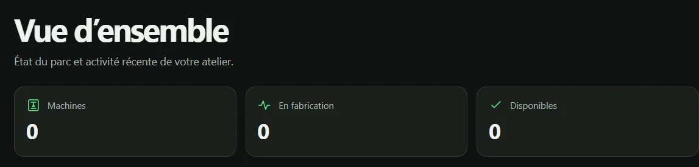

<h1 align="center">FabCore</h1>

<p align="center"><strong>Suivez votre parc machine depuis un seul tableau de bord.</strong></p>

<p align="center">
Gardez un œil sur vos fabrications, ouvrez les caméras en direct et voyez quelles bobines sont chargées. FabCore s’installe sur votre serveur et se connecte aux machines de votre atelier.
</p>

<p align="center">
<a href="#installation"><strong>Installer FabCore</strong></a> ·
<a href="#machines-compatibles">Voir les machines compatibles</a> ·
<a href="poc/README.md">Lire le guide de configuration</a>
</p>



**POC clôturé le 22 novembre 2026 sur P2S et deux CC2.** [Bilan et limites](docs/POC-BILAN.md) · [Migration vers le MVP](docs/MIGRATION-MVP.md). [Release « POC v0 » publiée](https://github.com/enamaryn/FabCORE/releases/tag/poc-v0). La migration technique du MVP est engagée. Le socle React et le parc (#126), puis le cockpit machine à six blocs (#127), sont fusionnés et accessibles sur `/app`. Le parcours React des fichiers et transferts est en revue : recherche, tri, pagination, téléchargement, envoi et transferts multiples avec lancement séparé. Le visualiseur, les logs et les outils non encore migrés restent accessibles dans l’interface actuelle.

## Ce que vous pouvez faire

- **Suivre vos fabrications.** Retrouvez l’état des machines, les températures et l’avancement sur une même page. Pilotez les machines selon les capacités de leur connecteur ; le pilotage P2S LAN et les commandes Pause/Stop CC2 ont été confirmés sur matériel.
- **Voir la pièce en cours.** Ouvrez la caméra d’une Bambu Lab P2S ou d’une Elegoo Centauri Carbon compatible depuis sa fiche. Une caméra hybride expérimentale pour une P2S enregistrée en Cloud est en revue : télémétrie Cloud et vidéo LAN RTSPS explicitement séparées ; [configuration et limites](docs/protocols/BAMBU-CLOUD-CAMERA.md).
- **Repérer la bonne bobine.** Consultez les emplacements AMS et CANVAS, leur occupation, la matière, la couleur et l’emplacement actif selon les données fournies par l’imprimante.
- **Gérer les accès.** Créez des comptes Observateur en lecture seule ou connectez votre fournisseur OIDC, comme [Pocket ID](poc/README.md#connexion-oidc-avec-pocket-id).
- **Diagnostiquer une coupure.** Filtrez le journal par machine et vérifiez l’heure du dernier rapport MQTT et de la dernière image reçue.
- **Préparer les notifications.** Configurez [ntfy interne ou externe et SMTP](poc/README.md#notifications-ntfy-et-smtp), puis envoyez une notification de test.

## Machines compatibles

| Machine | État | Caméra | Filaments | Fichiers / lancement* | Commandes* |
| --- | --- | --- | --- | --- | --- |
| Klipper avec Moonraker | Oui | — | — | Oui | Pause, reprise, stop |
| OctoPrint | Oui | — | — | Oui | Pause, reprise, stop |
| PrusaLink (API v1 avec clé) | Oui | — | — | Oui | Pause, reprise, stop |
| Bambu Lab P2S | Oui | Oui | AMS | G-code / 3MF tranché à un plateau | Pause, reprise, stop |
| Elegoo Centauri Carbon (CC1) | Oui | Oui | — | Fichiers envoyés via FabCore | Pause, reprise, stop |
| Elegoo Centauri Carbon 2 (CC2) | Oui | Oui | CANVAS | Fichiers internes, envoi et lancement | Pause, stop ; reprise sur la machine |
| xTool M2 | Oui | Trois vues | — | Aperçu G-code local ; projet préparé sur la M2 | Lancer le projet préparé, pause, reprise, stop |

*Le POC a été validé sur **P2S LAN et deux CC2**, dont le pilotage et le lancement depuis les fichiers internes CC2. Les autres connecteurs conservent leurs niveaux de recette et limites propres ; leur présence dans ce tableau ne vaut pas validation complète sur matériel. Le visualiseur G-code local est disponible sur toutes les fiches. Les lancements Bambu/Elegoo sont limités à la bobine externe avec confirmation ; le transfert natif des projets xTool M2 reste à implémenter. [Formats, limites et recette](poc/README.md#fichiers-et-pilotage--extension-expérimentale).

La connexion et les fonctions locales dépendent du modèle, du micrologiciel et des réglages réseau de la machine.

## Installation

**Debian ou Ubuntu**, sur un serveur personnel ou dans un **LXC Proxmox**. Pour démarrer avec un petit parc, prévoir **1 vCPU, 512 Mo de RAM et 1 Go d’espace libre** en plus du système. Le serveur doit pouvoir joindre les machines sur le réseau local. Un usage régulier des caméras peut demander davantage de ressources.

Avec `curl` installé, lancez cette commande depuis le dossier dans lequel vous voulez créer `FabCORE/`.

```bash
installer=$(curl -fsSL https://raw.githubusercontent.com/enamaryn/FabCORE/main/scripts/install.sh) && bash -c "$installer"
```

Le script télécharge le projet, installe les dépendances manquantes, dont Node.js 24 et FFmpeg, puis lance FabCore dans le terminal. Il utilise `sudo` pour les paquets système si nécessaire. Dans un LXC Debian minimal, installez d’abord `curl` en root avec `apt-get update && apt-get install -y curl`. Si vous avez déjà cloné le dépôt, lancez `bash scripts/install.sh` depuis sa racine.

Ouvrez <http://127.0.0.1:3000> et utilisez le jeton affiché pour créer votre compte administrateur. Pour un serveur distant, suivre le [guide d’accès par tunnel SSH ou reverse proxy HTTPS](poc/README.md#4-ouvrir-linterface).

## Mise à jour et sauvegardes

L’installation fournit la commande d’administration `fabcore` (`fabcore help` liste tout) :

| Commande | Rôle |
| --- | --- |
| `fabcore update` | Sauvegarde automatique, puis mise à jour depuis `main` (`--check` : comparer sans déployer) |
| `fabcore backup` | Archive horodatée des données, des clés et de la base PostgreSQL éventuelle, avec empreinte SHA-256 |
| `fabcore backups` | Liste des sauvegardes (les 10 dernières sont conservées) |
| `fabcore restore <archive>` | Remet une sauvegarde en place après confirmation et sauvegarde de l’état actuel (`--check` : vérifier sans rien modifier) |
| `fabcore import` | Passage de `state.json` à PostgreSQL (simulation, puis `--apply`) |
| `fabcore database check` | Vérifie la base configurée : connexion, TLS, version ≥ 16, droits de création |
| `fabcore database setup` | Tout-en-un : installe PostgreSQL local, crée la base, importe `state.json` et bascule le service |
| `fabcore status` | Version, service, stockage et dernière sauvegarde |

Si FabCore tourne dans le terminal, arrêtez-le avec `Ctrl+C`, puis lancez `fabcore update` avec le compte utilisé pour l’installation. Relancez ensuite `bash scripts/install.sh` depuis le dossier FabCore. Un service systemd actif nommé `fabcore` est redémarré automatiquement si son dossier de travail correspond à cette installation, et arrêté le temps d’une restauration. `fabcore-update` reste disponible et équivaut à `fabcore update` ; une installation antérieure obtient la commande `fabcore` en relançant `bash scripts/install.sh`. Si la commande est absente du PATH, utilisez `/usr/local/bin/fabcore` (root) ou `~/.local/bin/fabcore` (utilisateur). Les sauvegardes sont dans `.fabcore-backups` du dossier FabCore ; copiez-les aussi hors de la machine.

## Ajoutez votre première machine

Lancez la **découverte réseau** depuis **Ajouter une machine**. FabCore préremplit les informations trouvées. Renseignez le code d’accès si la machine en demande un, puis testez la connexion. Vous pouvez aussi saisir son adresse IP manuellement.


La bibliothèque centralisée et les alertes automatiques de fabrication sont prévues. Le transfert depuis les fiches compatibles est décrit dans le guide. [Consulter la licence](LICENSE).

## Contribuer avec une IA

**Commencer par [AGENTS.md](AGENTS.md), à la racine.** Il regroupe la phase active, les points d’entrée directs par sujet, les commandes de vérification et les règles de contribution. Pour Claude Code, [CLAUDE.md](CLAUDE.md) importe cette même référence ; les consignes ne sont pas dupliquées.

Pour trouver une fonctionnalité sans charger tout le dépôt :

```bash
node scripts/ai-context.mjs --list
node scripts/ai-context.mjs cc2-files
node scripts/ai-context.mjs --check
```

La [carte du code](docs/ai/CODEMAP.md) relie 11 sujets aux sources, symboles, tests et guides. Les recherches retournent les lignes et empreintes actuelles ; ouvrir ensuite uniquement les extraits utiles. La CI vérifie les chemins et déclarations référencés ; elle ne prouve pas à elle seule les relations fonctionnelles.

Cinq [profils spécialisés](.codex/agents/) sont disponibles pour les clients Codex locaux compatibles : navigation, connecteurs, backend, frontend et revue qualité. Leur chargement dans un autre client doit être vérifié. Un seul agent pour une tâche simple ; délégation ciblée pour les tâches indépendantes, avec retour court. [Méthode et relais](docs/ai/WORKFLOW.md).

**Serena reste facultatif et désactivé par défaut.** L’installation et le handshake MCP ont été testés, mais le serveur de langage TypeScript n’a pas pu s’initialiser dans l’environnement d’essai. La carte et la recherche locale fonctionnent sans lui. [Résultat du pilote](docs/ai/SERENA.md) · [Vérifications et mesures](docs/ai/EVALUATION.md).

L’adresse racine `/` rejoint automatiquement `/app` : le parc et les fiches machine utilisent la même interface. Les outils encore en migration restent accessibles par leurs liens spécifiques.
