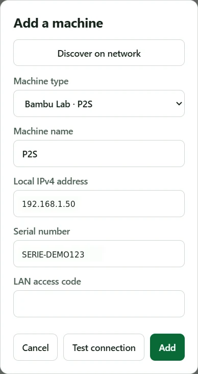

# FabCore

FabCore est un tableau de bord auto-hébergeable pour suivre des imprimantes 3D sur le réseau local. Il affiche l’état, les températures et la progression des machines et permet d’ouvrir la caméra des Elegoo compatibles.

**Machines prises en charge** · Klipper/Moonraker, Bambu Lab P2S, Elegoo Centauri Carbon et Centauri Carbon 2.

## Installation

Prérequis · Linux ou LXC, Git, **Node.js 24** et npm. Pour démarrer sur un serveur personnel, prévoir **1 vCPU, 512 Mo de RAM et 1 Go d’espace disque libre** en plus du système. Ces ressources sont indicatives pour un petit parc. Chaque flux caméra ouvert utilise de la bande passante. Le serveur doit pouvoir joindre les imprimantes sur le réseau local.

```bash
git clone https://github.com/enamaryn/FabCORE.git
cd FabCORE
npm ci
npm start
```

Ouvrir <http://127.0.0.1:3000> et créer le compte administrateur avec le jeton affiché dans le terminal. Pour un serveur distant ou un LXC, utiliser un [tunnel SSH ou un reverse proxy HTTPS](poc/README.md#4-ouvrir-linterface). Les données sont conservées dans `.fabcore/` par défaut.

## Aperçu

**Vue d’ensemble** · L’état du parc et les impressions en cours.


**Ajouter une machine** · La découverte réseau peut préremplir le modèle, l’adresse et le numéro de série. Saisir le code LAN si nécessaire, puis tester la connexion.


